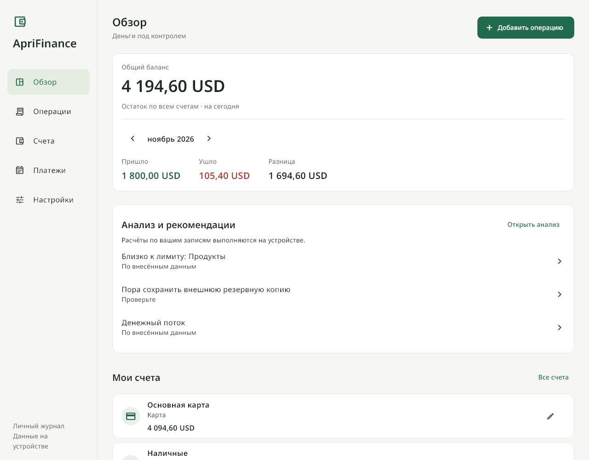

# ApriFinance

Личный учёт финансов для Windows: доходы, расходы, переводы, возвраты, счета, регулярные платежи, покупки, чеки и гарантии.



## Возможности

- Единая валюта базы: AZN, RUB, USD, EUR, TRY или GBP.
- Счета, начальные остатки, журнал операций, поиск и фильтры.
- Баланс на сегодня. Будущие записи остаются в журнале и применяются в календарном прогнозе своей даты.
- Месячные лимиты с учётом возвратов и подтверждённых алиасов категорий.
- Подписки и счета с повторением, подтверждение оплаты и пропуск периода.
- Покупки, документы JPEG/PNG/PDF, сроки возврата и гарантии.
- Зашифрованные резервные копии .mfin, проверка перед восстановлением и защитная копия прежнего состояния. Экспорт операций в CSV.
- 90 правил анализа: изменения расходов и доходов, повторы, необычные суммы, резервы, цели, долги, сценарии сокращений, сезонность и проверка качества прогноза.

Вход в рекомендации: **Обзор → Открыть анализ**. В **Данных анализа** задаются метки, резервы, цели, долги и параметры сценариев. Правила используют достаточность и подтверждённую полноту данных. Совпадения проверяются вручную; рекомендации не меняют финансовые операции автоматически.

## Установка Windows

Версия 1.0; Windows проверен в сборке 19. Android/macOS и расширенный обмен — сборка 20 для личного тестирования. Требуется Windows 10 x64, сборка 19041 или новее.

Запустите ApriFinance-1.0.0-Windows-x64-Setup.exe. Установка выполняется для текущего пользователя, без прав администратора. Перед обновлением закройте приложение. Удаление программы сохраняет отдельную папку данных. ZIP-вариант необходимо распаковать целиком и запускать ApriFinance.exe вместе с включёнными библиотеками.

Установщик и EXE пока без подписи издателя. Системные уведомления Windows отключены. Синхронизация остаётся экспериментальной и не входит в проверенный локальный сценарий. Android и macOS собираются отдельно через GitHub Actions; проверяйте статус запуска перед скачиванием. Тестовые сборки публикуются как prerelease после успешной проверки.

## Данные и резервные копии

База SQLite хранится локально в %APPDATA%/com.bahadur/personal_finance/finance.sqlite. Её каталог сохранён для совместимости с прежними версиями. Локальная база не зашифрована; паролем защищён экспорт .mfin. Не публикуйте свою базу, документы, пароли и резервные копии.

Новая копия с данными анализа использует логический формат 5; поддерживается чтение старых форматов 2–4. Для восстановления новой копии используйте сборку 18 или новее. Перед заменой данных приложение сохраняет защитную копию с паролем восстановления. Забытый пароль копии восстановить нельзя.

## Разработка и проверка

Нужны Flutter **3.50.0** / Dart **3.14.0**, Visual Studio Build Tools с Desktop development with C++ и Windows SDK. Зависимости закреплены в pubspec.lock; обновление пакетов не требуется для сборки.

```powershell
flutter pub get --enforce-lockfile
./scripts/verify.ps1
./scripts/test-windows.ps1
./scripts/build-windows.ps1 -Compiler 'C:/Tools/NSIS/makensis.exe'
```

Для установщика используется NSIS 3.13. Сборочный скрипт проверяет включённые библиотеки Visual C++ и точное соответствие версии EXE. Он не скачивает и не устанавливает инструменты разработки.

Результат: dist/ApriFinance-1.0.0-Windows-x64-Setup.exe. Нативные тесты используют временные базы и отдельную идентичность окна; настоящие данные приложения не открываются.

Описание проверок: [итоговый аудит](docs/final-windows-audit-1.0.md), [проверка сборки](docs/TESTING.md). Лицензии зависимостей: [сторонние компоненты](THIRD_PARTY_NOTICES.md).

Copyright © 2026 Bahadur.

## Android, macOS и синхронизация

Сборка 20 включает обмен данными анализа. Настройка: [личное облако](cloud/README.ru.md). APK и Mac ZIP доступны в Releases после успешной сборки. Ограничения подписей и проверка перед переносом личных данных: [описание тестового выпуска](docs/RELEASE20.md).
